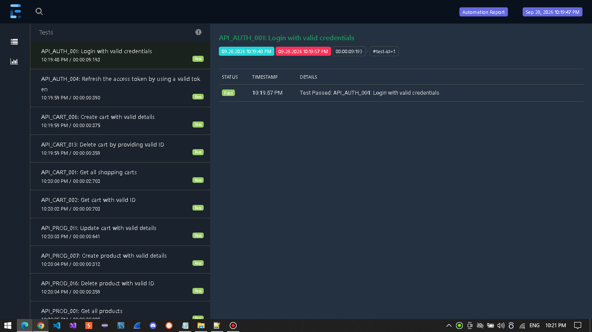
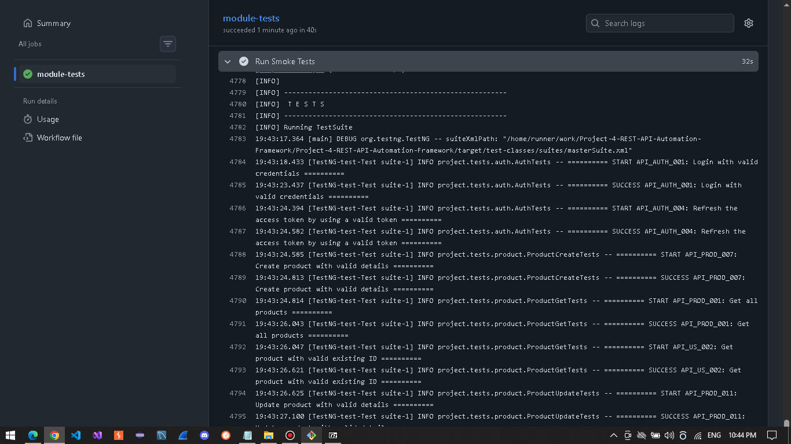

<a id="top"></a>
# Project 4 – REST API Automation Framework


> **Note:** This project is part of my personal QA Automation portfolio.

## Table of Contents

- [Overview](#overview)
- [Tech Stack](#tech-stack)
- [Framework Features](#framework-features)
- [Framework Architecture](#framework-architecture)
- [Test Execution](#test-execution)
- [Reports and Logging](#reports-and-logging)
- [Conclusion](#conclusion)

---

## Overview

 This automation framework is built using `Java`, `REST Assured`, `TestNG`, `Maven`, `Jackson` and `Lombok`. <br>The framework automates the following REST API services:
**Auth**, **Product**, **Cart**.

<p align="right">
  Application Under Test: <a href="https://dummyapi.codesmash.in">CodeSmash</a>
</p>

---

<a id="tech-stack"></a>
## 🛠️ Tech Stack

| Technology | Purpose |
|------------|---------|
| Java | Programming language |
| RestAssured | REST API automation |
| TestNG | Test execution and assertions |
| Jackson | JSON serialization/deserialization |
| Lombok | Boilerplate code reduction |
| Maven | Dependency and build management |

---

## Framework Features

- **Modular API Architecture:** Structured API services design.
- **JSON Schema Validation:** API response schema validation using `Rest Assured JSON Schema Validator`
- **Response Deserialization:** API response mapping using Jackson
- **Test Reporting:** Detailed reports using Extent Reports.
- **Execution Logging:** Structured execution logs using Logback.
- Test execution control through **Maven parameters**
- **GitHub Actions CI:** Two workflows for automated test execution — one manually triggered and one triggered on Pull Requests

---

<a id="framework-architecture"></a>
## 🏗️ Framework Architecture

The framework is organized into dedicated layers, each with a clear responsibility to improve
maintainability, reusability, and separation of concerns.

| Layer / Component | Purpose |
|-------------------|---------|
| Base | Provides common setup and reusable functionality for services and tests |
| Service | Encapsulates API endpoints and HTTP operations for each resource |
| Payload | Provides response models used for JSON serialization and deserialization |
| Expected | Centralizes expected values and reusable assertions data |
| Test Data | Generates and provides reusable test data for API test scenarios |
| Tests | Contains test scenarios organized by API resource and operation |
| Utils | Provides shared utilities for reporting, data reading, and JSON Schema validation |
| Schemas | Contains JSON Schemas used to validate API response structures |
| Test Data Files | Stores external JSON test data used by the framework |
| Suites | Defines TestNG test suites and execution configuration |

---

## Test Execution

### Run All Tests

```bash
# All Tests (41 tests)
mvn clean test
```

### Run Specific Test Suite 

```bash
# Smoke Tests (12 tests)
mvn clean test -DtestSuite=Smoke

# Test Service: Product service (18 tests) 
mvn clean test -DtestSuite=Product
```

---

### Reports

Test execution reports are generated using Extent Reports and located in the `reports/` directory.

<details>
<summary>📊 <strong>Report Preview</strong></summary>

<br>



</details>

### Logs

Execution logs are generated using Logback and SLF4J and located in the `logs/` directory.

<details>
<summary>📝 <strong>Logs Preview</strong></summary>

<br>



</details>

---

## Conclusion

The main focus of this project was to demonstrate a solid understanding of core API Automation concepts, particularly 
REST API testing, and their practical application within a structured and configurable framework.

**Author:** [DoruSQA](https://github.com/DoruSQA) | [LinkedIn](https://www.linkedin.com/in/sava-doru/)
<p align="right"><a href="#top">Back to Top</a></p>